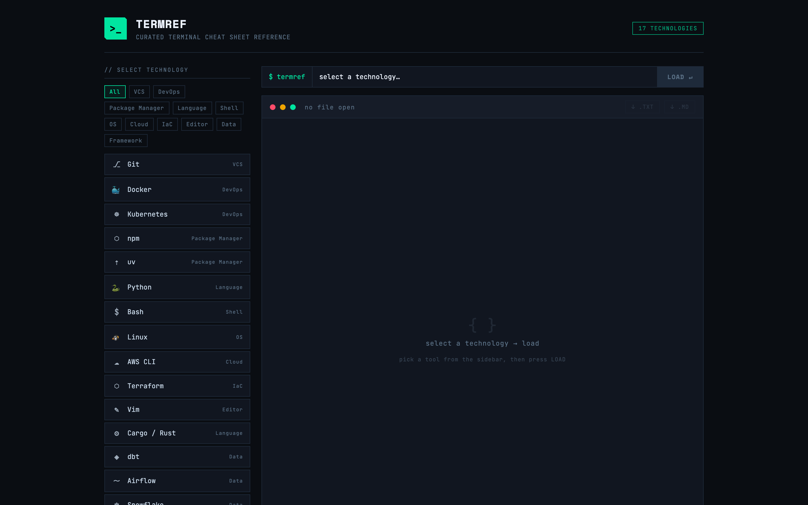
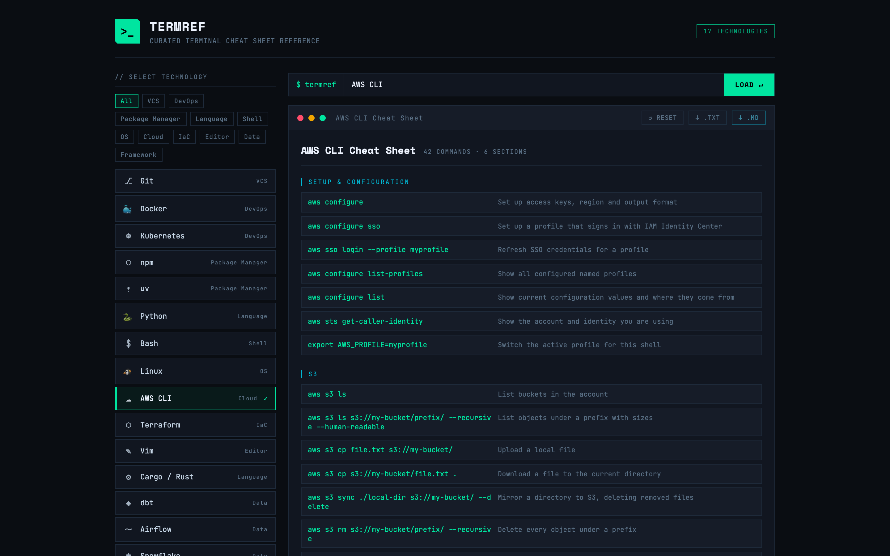

<div align="center">

# >_ TERMREF

**Curated terminal cheat sheet reference**

Pick a technology. Hit load. Get a clean, downloadable reference card, instantly.

**Status: ACTIVE**



<br><br>

[](https://nextjs.org)
[](https://react.dev)
[](https://typescriptlang.org)
[](LICENSE)

</div>

---

## Features

<div align="center">



<br><br>

</div>

- **17 technologies**: Git, Docker, Kubernetes, Python, uv, Bash, AWS CLI, Terraform, dbt, Airflow 3, Snowflake, Spark and more
- **Category filtering**: browse by DevOps, Language, Cloud, Data, etc.
- **Instant loading**: select a tool, press Load, get a structured cheat sheet immediately
- **Download as .TXT or .MD**: export for offline use or paste into docs
- **Verified, with a date**: every sheet shows the tool version it was checked against and when, e.g. `Airflow 3.4 · verified 14 Nov 2026`, with links to the official docs used
- **Kept current**: a weekly GitHub Action opens an issue when a tool ships a new release line, and sheets older than six months turn amber
- **Report an outdated command**: each sheet links to a pre-filled GitHub issue
- **Pre-built content**: cheat sheets are stored as static JSON, bundled at build time and validated in CI
- **Terminal-inspired UI**: dark theme, monospace fonts, zero fluff

## Supported Technologies

<p>
  
  
  
  
  
  
  
  
  
  
  
  
  
  
  
  
  
</p>

## How Sheets Stay Current

Every sheet carries its own verification record:

```json
"verified": "2026-11-14",
"version": "Airflow 3.4",
"sources": ["https://airflow.apache.org/docs/apache-airflow/stable/cli-and-env-variables-ref.html"],
"watch": [{ "name": "Airflow", "source": "pypi:apache-airflow", "checked": "3.4.0", "level": "minor" }]
```

`verified` is the date the sheet was last checked line by line against the official docs and the tool's own `--help` output. It is never the git commit date, because reformatting a file changes that without anyone checking the content. A sheet that has not been checked shows "not yet verified" instead of a date.

The full verification pass on 14 Nov 2026, with the method used for each sheet and every row that changed, is logged in [docs/verification-2026-11-14.md](docs/verification-2026-11-14.md).

Three things keep the dates honest:

1. **Weekly version watch** (`.github/workflows/version-watch.yml`, Mondays 06:17 UTC). For each `watch` entry it looks up the latest stable release on PyPI, npm, GitHub releases or git tags. When a new release line appears it opens one issue, e.g. "Airflow 3.5 released: re-verify the airflow sheet", labelled `version-watch`. Issues are deduplicated by title across open and closed issues, so patch releases and closed issues never reopen it. `level: "minor"` reacts to 3.4 → 3.5; `level: "major"` only to 2.x → 3.x, which suits tools that ship a minor almost every week (AWS CLI, Docker, npm, Snowflake CLI). Bash, Linux and Rust have no watch: the staleness check covers them.
2. **Staleness**: six months after `verified`, the date turns amber in the UI and `pnpm validate` prints a warning. It never fails CI, so time passing alone can't break the build.
3. **Reader reports**: the "report an outdated command" link opens a pre-filled issue from `.github/ISSUE_TEMPLATE/outdated-command.md`, which labels it `outdated` (the weekly job creates that label).

Run the watch locally with `node scripts/version-watch.mjs` (report only). GitHub disables scheduled workflows in public repos after 60 days without repository activity; if that happens, re-enable it from the Actions tab.

## Tech Stack

| Layer | Tech | |
|-------|------|---|
| Framework | Next.js 16 (App Router) |  |
| UI | React 19 + custom CSS |  |
| Fonts | JetBrains Mono, Space Mono |  |
| Data | Static JSON cheat sheets, validated by `scripts/validate-sheets.mjs` | |
| Language | TypeScript 5 |  |
| Package Manager | pnpm |  |

## Getting Started

### Prerequisites

-  (the tests import TypeScript directly)
- 

No environment variables or API keys are required.

### Setup

```bash
git clone https://github.com/PantelisTsagkas/termref.git
cd termref
pnpm install
pnpm dev
```

Open [http://localhost:3000](http://localhost:3000).

### Checks

```bash
pnpm lint       # ESLint
pnpm validate   # cheat sheet shape, style and verification metadata
pnpm test       # export, staleness and version-watch logic tests
pnpm build      # production build
```

CI runs all four on pushes to main and on pull requests.

## Project Structure

```
termref/
├── app/
│   ├── components/
│   │   └── termref-app.tsx      # Main client component
│   ├── globals.css              # Reset
│   ├── termref.css              # Terminal theme styles
│   ├── layout.tsx               # Root layout + fonts
│   └── page.tsx                 # Entry page
├── data/cheatsheets/            # Pre-built JSON cheat sheets (one per tech)
├── docs/
│   ├── verification-2026-11-14.md  # How each sheet was verified
│   ├── termref-aws.png          # README screenshot
│   └── termref-empty-state.png  # README screenshot
├── lib/
│   ├── cheat-sheet.ts           # Types + TXT/Markdown formatters
│   ├── cheatsheets.ts           # Static sheet registry
│   ├── sheet-meta.ts            # Verification dates, staleness, version comparison
│   └── technologies.ts          # Tech list + categories
├── scripts/
│   ├── validate-sheets.mjs      # Sheet validator (--fix reformats)
│   └── version-watch.mjs        # Weekly latest-release check
├── tests/
│   ├── cheat-sheet.test.mjs     # Export formatter tests
│   └── sheet-meta.test.mjs      # Staleness and version-watch tests
└── package.json
```

## Adding or Updating Cheat Sheets

Each technology has a JSON file in `data/cheatsheets/` (e.g. `git.json`). To add a new tech:

1. Add an entry to `lib/technologies.ts`
2. Create `data/cheatsheets/<id>.json` following the existing format
3. Import it in `lib/cheatsheets.ts`
4. Run `pnpm validate --fix` to check it and normalise the layout

New sheets start with `"verified": null`. Before setting a date, check every row against the current release (its `--help` output and official docs), then fill in `verified`, `version`, `sources` and a `watch` entry. To close a `version-watch` issue, re-check the sheet against the new release and update `verified`, `version` and the entry's `checked` version.

Section titles are UPPER CASE, descriptions have no trailing period, and every command in a sheet is unique. The build also fails if a technology and its sheet don't match up.

---

<div align="center">

**Built with** 

MIT License

</div>
